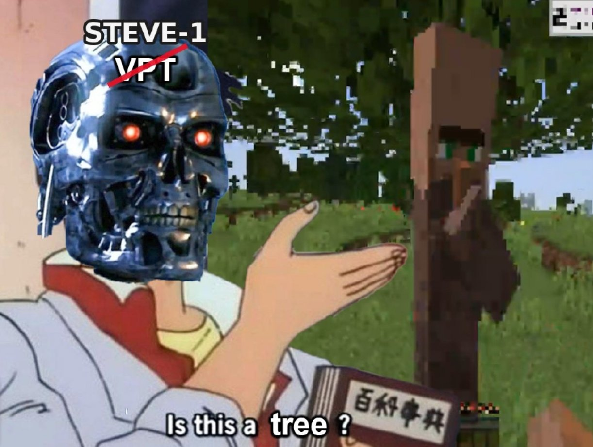
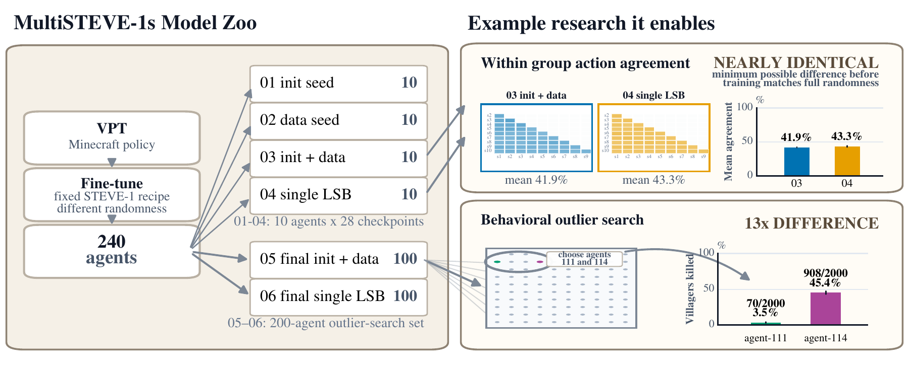

# MultiSTEVE-1s: A Model Zoo and Interpretability Suite for Instruction-Following Vision Agents

### [Website](https://sites.google.com/view/multisteve-1s) | [Paper](https://openreview.net/pdf?id=sR3tHXbQxm) | [Hugging Face](https://huggingface.co/MultiSTEVE-1s) | [Attention demo](https://multisteve-1s.netlify.app/) | [Interpretability bundle](https://huggingface.co/datasets/MultiSTEVE-1s/interactive-explorers)



*Meme credit: [@Wurst_Imperium](https://x.com/Wurst_Imperium/status/1814202960370417823).*



MultiSTEVE-1s provides **240 instruction-following Minecraft agents and 1,520 checkpoints**, with tools to compare their behaviour, explore their trajectories, and inspect their attention. The model zoo spans six groups, including 100 additional single-bit-flip agents in `06_final_single_lsb_flip_100`.

Explore the [attention demo](https://multisteve-1s.netlify.app/) in your browser, or download the [interpretability bundle](https://huggingface.co/datasets/MultiSTEVE-1s/interactive-explorers) to inspect recorded trajectories and attention locally, with no model downloads or installation. Use this repository to run agents, reproduce the paper's figures, and conduct training, evaluation, and interpretability experiments. Cached summaries are included for figure regeneration.

See the [model-zoo guide](docs/model_zoo.md) for model groups and checkpoints, and [Data and weights](docs/data_and_weights.md) for Hugging Face download commands and the local artifact layout. Model weights, training datasets, raw rollout logs, videos, and generated dashboards are distributed separately from this code repository.

## Quick Start

### Try the browser demo

Open the [attention demo](https://multisteve-1s.netlify.app/) to inspect recorded agent attention without installing anything.

### Download the interpretability bundle

The [interpretability bundle](https://huggingface.co/datasets/MultiSTEVE-1s/interactive-explorers) includes an attention-pattern viewer, a 3D T-maze trajectory viewer, and two scatter explorers, together with their recorded data. Explore trajectories and attention locally without model weights, a GPU, or a Python environment.

1. Download the ZIP from the dataset page (approximately **3.53 GB**; **6.38 GB** unpacked).
2. Extract the entire archive, keeping its folders together.
3. Double-click `index.html` to open the launcher in a desktop browser, then choose an explorer.

The bundle explores selected recorded experiments. To run new agent episodes or change instructions and environments, install the code environment below and follow the [rollout and evaluation guide](docs/evaluations.md).

### Set up the code environment

**Use [KarolisRam/minerl](https://github.com/KarolisRam/minerl/tree/dev) for MineRL.** This fork provides the chat-command support used by our creative-mode placement, T-maze, and villager-tree workflows. See [upstream MineRL issue #747: “How can I use ChatAction?”](https://github.com/minerllabs/minerl/issues/747) for background on the upstream chat-action limitations that motivate using this fork. `environment.yml` installs a pinned revision of the fork's `dev` branch automatically, together with CUDA-enabled PyTorch, MineCLIP, and the VPT dependencies. Install Java JDK 8, Git, and a C/C++ build toolchain before creating the environment. Headless rollouts also require Xvfb (`xvfb-run`).

Run commands from the repository root with this checkout first on `PYTHONPATH`:

```bash
conda env create -f environment.yml
conda activate steve-1-creative
```

### Run your first agent

With the environment activated, download the base assets and one MultiSTEVE-1s final checkpoint. Run these commands from the repository root:

```bash
bash download_weights.sh

hf download MultiSTEVE-1s/MultiSTEVE-1s \
  03_init_and_data/dataset_seed1-weight_init_seed1/STEVE-1_snapshot_160005120.weights \
  --local-dir data/model_zoo
```

Run one episode with the instruction **“chop a tree”** in environment seed **49**, for up to **1,000 agent steps**:

```bash
PYTHONPATH="$PWD${PYTHONPATH:+:$PYTHONPATH}" \
  python -m steve1.run_agent.run_agent_with_logging \
  --in_model data/weights/vpt/2x.model \
  --in_weights data/model_zoo/03_init_and_data/dataset_seed1-weight_init_seed1/STEVE-1_snapshot_160005120.weights \
  --custom_text_prompt "chop a tree" \
  --seed 49 \
  --custom_text_seed 0 \
  --gameplay_length 1000 \
  --save_dirpath outputs/first_rollout
```

Open `outputs/first_rollout/<timestamp>/video.mp4` to watch the result. The same folder contains the command, prompt, seed, action, inventory, and location logs.

**Optional: spawn a villager-tree.** Add the following argument to the rollout command to place a villager beneath an oak-leaf canopy near the starting position:

```text
--placement "side=left,villager=true,tree_type=oak"
```

For example, replace the final line of the command with:

```bash
  --save_dirpath outputs/first_rollout \
  --placement "side=left,villager=true,tree_type=oak"
```

This uses the creative-command support in the MineRL fork installed above. Set `villager=false` in the placement argument to place a regular tree instead.

Change `--custom_text_prompt` to give a different instruction, `--seed` to select a different Minecraft world, or `--in_weights` to compare another agent. `--custom_text_seed` controls sampling of the text-conditioning embedding; it is separate from the environment seed and does not make the whole rollout deterministic. For headless Linux, replace `python -m` with `xvfb-run -a python -m` in the command above. See the [evaluation guide](docs/evaluations.md) for campaigns and the [interpretability guide](docs/interpretability_suite.md#t-maze-and-villager-tree-construction) for creative environment changes.

### Reproduce cached figures

Figure regeneration uses the included summaries and does not require downloading model weights:

```bash
python -m multisteve.plot_suite.cli list --config configs/plot_suite/final.json
python -m multisteve.plot_suite.cli run --from-cache --config configs/plot_suite/final.json --no-overleaf
```

## Download Models and Data

The first-rollout example above downloads one final checkpoint plus the base assets supplied by `download_weights.sh`. The MultiSTEVE-1s checkpoint does not replace the base model configuration, MineCLIP, or STEVE-1 prior dependencies.

[Data and weights](docs/data_and_weights.md) includes commands for a full model group, all checkpoints, the embedded training datasets, and seed images. The full model zoo is approximately 1.5 TB; download only the checkpoints needed for your workflow.

## Repository Map

- `steve1/`: STEVE-1/VPT training, rollout, evaluation, fake-env, teleport, and queue source.
- `multisteve/`: paper-specific plotting, creative-environment utilities, checkpoint/L2 analyses, and action-probability code.
- `configs/eval_campaigns/`: compact evaluation campaign configs.
- `outputs/plot_suite/cache/`: cached summaries for figure regeneration.
- `run_agent/`: shell wrappers for episode queues and T-maze campaigns.
- `scripts/`: training-command generator, campaign generator, and utility hooks.
- `tools/`: villager, action-probability, attention-dashboard, and world-viewer helpers.
- `train/`: dataset, sampling, and training wrapper scripts.
- `docs/`: detailed reproduction and release documentation.

## Main Workflows

Training command generation:

```bash
conda run -n steve-1-creative env PYTHONDONTWRITEBYTECODE=1 PYTHONPATH="$PWD${PYTHONPATH:+:$PYTHONPATH}" \
  python -m scripts.train_zoo --group all
```

Episode queue dry run:

```bash
run_agent/episode_queue.sh enqueue --campaign configs/eval_campaigns/full_partial_eval.json --dry-run
```

T-maze campaign:

```bash
run_agent/build_tmaze_campaign.sh data/tmaze_100_model_campaign
run_agent/run_tmaze_campaign.sh data/tmaze_100_model_campaign --max_parallel 1
run_agent/analyze_tmaze_campaign.sh data/tmaze_100_model_campaign
```

Interactive T-maze scatter explorer from included caches:

```bash
conda run -n steve-1-creative env PYTHONDONTWRITEBYTECODE=1 PYTHONPATH="$PWD${PYTHONPATH:+:$PYTHONPATH}" \
  python -m tools.interactive_scatter.build_tmaze_scatter_explorer \
  --out-html outputs/interactive/tmaze_choice_scatter_explorer.html \
  --show-ci-default
```

Generate the Agent-111/Agent-114 seed-sweep campaign manifest:

```bash
conda run -n steve-1-creative env PYTHONDONTWRITEBYTECODE=1 PYTHONPATH="$PWD${PYTHONPATH:+:$PYTHONPATH}" \
  python -m scripts.build_eval_campaigns \
  --campaign agent_111_114_seed_sweep \
  --out data/generated_campaigns/villager_agent_111_114_seed_sweep.json
```

Generate the paper's bitflip-2 versus bitflip-8 villager-tree sweep:

```bash
conda run -n steve-1-creative env PYTHONDONTWRITEBYTECODE=1 PYTHONPATH="$PWD${PYTHONPATH:+:$PYTHONPATH}" \
  python -m scripts.build_eval_campaigns \
  --campaign bitflip2_vs_8_sweep \
  --out data/generated_campaigns/villager_bitflip2_vs_8_sweep.json
```

Generate a short 17-episode smoke campaign:

```bash
conda run -n steve-1-creative env PYTHONDONTWRITEBYTECODE=1 PYTHONPATH="$PWD${PYTHONPATH:+:$PYTHONPATH}" \
  python -m scripts.build_eval_campaigns \
  --campaign release_smoke_17_episodes \
  --out data/generated_campaigns/release_smoke_17_episodes.json
```

## Documentation

- [Data and weights](docs/data_and_weights.md): required external artifacts and expected paths.
- [Model zoo](docs/model_zoo.md): all six model groups, released checkpoint layout, and group-06 workflows.
- [Training](docs/training.md): 240-model training setup and command generation.
- [Evaluations](docs/evaluations.md): queue orchestrator, campaign configs, T-maze, villager, and smoke tests.
- [Plots](docs/plots.md): cached figure regeneration and plot-suite structure.
- [Interpretability suite](docs/interpretability_suite.md): attention logging, fake-env replay, T-maze, trajectories, and viewer hooks.
- [Reproducibility](docs/reproducibility.md): import rules and reproducibility limits.
- [Seed library](docs/seed_library.md): seed lists included in the paper workflows.

## External Artifacts

Expected base paths are documented in `docs/data_and_weights.md`. The most common paths are:

```text
data/weights/vpt/2x.model
data/weights/vpt/rl-from-foundation-2x.weights
data/weights/steve1/steve1_prior.pt
data/model_zoo/<group>/<model>/STEVE-1_snapshot_160005120.weights
data/final-evals/
data/evals-villager/
```

Use `download_weights.sh` for public base STEVE-1/VPT assets. The MultiSTEVE-1s model zoo and raw rollout artifacts are external to this source repository.

## Citation

```bibtex
@inproceedings{jucys2026multisteve,
  title = {{MultiSTEVE-1s}: A Model Zoo and Interpretability Suite for Instruction-Following Vision Agents},
  author = {Jucys, Karolis and Adamopoulos, George and {\c{S}}im{\c{s}}ek, {\"O}zg{\"u}r},
  booktitle = {Advances in Neural Information Processing Systems},
  year = {2026},
  note = {To appear}
}
```
